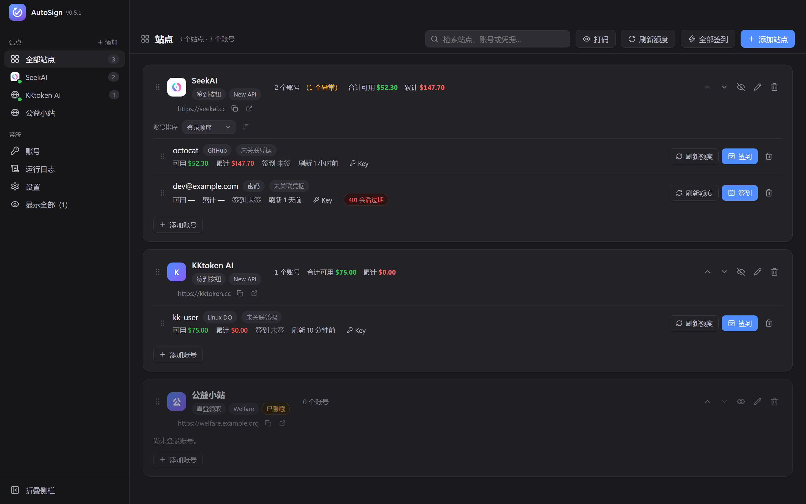
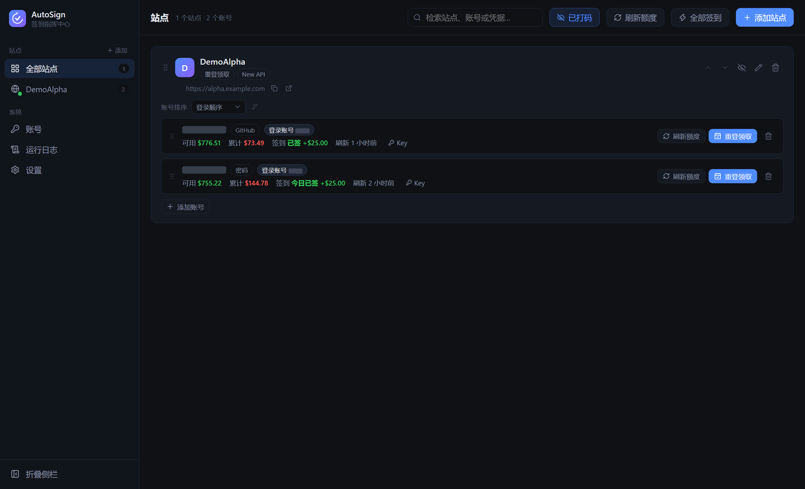
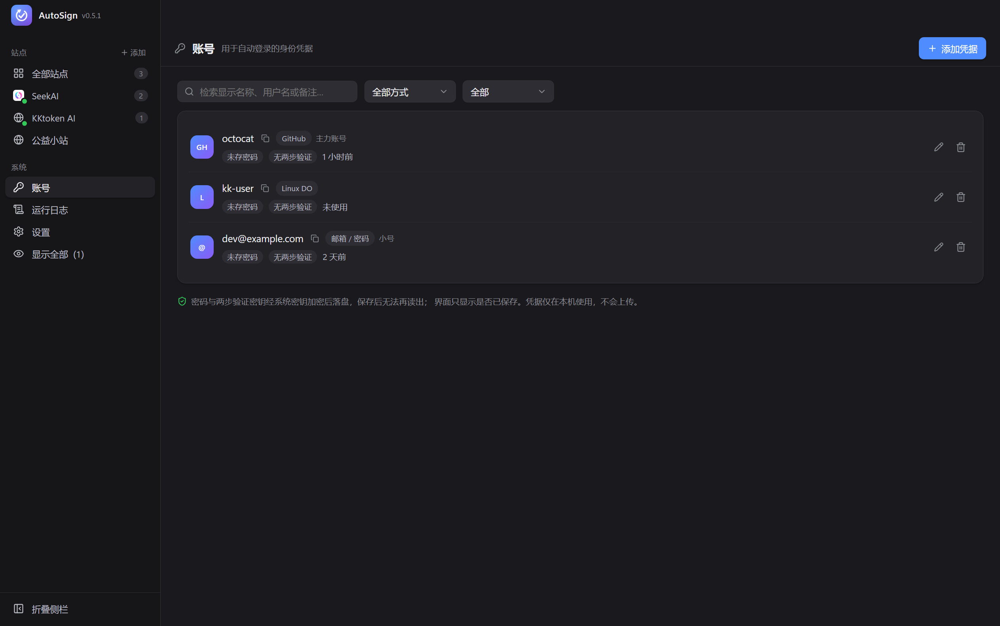
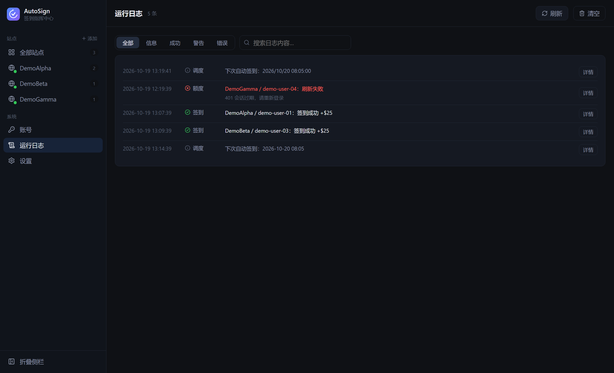

# AutoSign Desktop

桌面端公益 AI 中转站自动签到与额度管理，Electron + React + TypeScript。

> 本项目是 [AI-modelsAPI/autosign](https://github.com/AI-modelsAPI/autosign)（Android，AGPL-3.0-or-later）
> 的桌面重实现，沿用其站点协议与安全策略，界面与运行时完全重写。
> 原项目只维护 Android 端，本项目面向 Windows / macOS / Linux。



## 功能

- **左侧站点菜单**：站点列表常驻，可整栏折叠为图标条，也可把单个站点隐藏后恢复。
- **多站点多账号**：每个「站点 × 账号」使用独立持久化分区，Cookie 互不串号。
- **额度看板**：可用额度、累计消耗、今日签到状态与奖励，支持一键刷新全部并显示逐个账号的进度。
- **签到**：按站点能力自动选择按钮签到 / 重登领取 / 登录即得，不伪造成功。
- **Turnstile**：隐藏窗口复用站点自身挂件完成无感人机验证，不破解、不代答。
- **会话自愈**：短期令牌过期用 refresh cookie 续期；并发续期合并；409 会话上限立即停止。
- **后台定时**：主进程内调度，关闭窗口后仍按时执行，结束后发系统通知。
- **代理**：支持跟随系统（注册表 / scutil / 环境变量）、手动 http/socks5、直连。
- **凭据加密**：会话 Cookie 与令牌经系统密钥（DPAPI / Keychain / libsecret）加密，不可用时拒绝明文落盘。
- **账号打码**：一键把账号名、登录邮箱、凭据用户名与日志中的账号换成灰色遮罩块，
  原始字符不进入页面，便于截图分享。
- **窗口记忆**：记住窗口大小与位置；外接屏拔掉后自动回到主屏，不会留在看不见的地方。
- **自动更新**：安装版启动后后台检查 GitHub Release，自动下载，退出时安装。

### 账号打码

顶部「打码」按钮或设置页开关即可切换。开启后账号信息被整块遮住，
站点名、额度与签到状态仍然可读，适合分享截图或演示：



### 账号与凭据

凭据与站点账号分开维护：一份凭据可以授权多个站点，添加账号时选中即可自动填表。



### 运行日志

签到、刷新、登录与调度都会留痕，可按级别筛选、检索并展开详情。



## 快速开始

```bash
npm install
npm run dev        # 开发模式
npm run typecheck  # 类型检查
npm run build      # 生产构建
npm test           # 单元测试
npm run smoke      # 冒烟测试（需先 build）
npm run verify:ui  # 界面元素验证（需先 build）
npm run dist       # 打安装包
```

要求 Node.js ≥ 22.12（Electron 44 的运行要求）。

## 版本与发布

### 版本号规则

版本号唯一来源是 `package.json` 的 `version`，用 `npm version` 维护：

```bash
npm version patch -m "chore: 发布 v%s"   # 或 minor / major
git push --follow-tags
```

| 位 | 何时递增 |
|---|---|
| MAJOR | 不兼容变更：配置无法迁移、破坏既有账号数据 |
| MINOR | 向下兼容的新功能 |
| PATCH | 向下兼容的问题修复 |

预发布使用 `0.2.0-beta.1` / `0.2.0-rc.1` 形式，不带 `v` 前缀。

### 发布流程

「里程碑」即打正式 tag。推送 tag 会触发 GitHub Actions：

1. 运行敏感信息扫描、类型检查、单元测试、界面验证；
2. 校验 tag 与 `package.json` 版本一致，不一致直接失败；
3. 三平台并行打包（Windows NSIS / macOS DMG / Linux AppImage）；
4. 产物与 `latest.yml` 上传到该 tag 对应的 Release。

```bash
git tag -l                       # 查看已有里程碑
npm version minor -m "chore: 发布 v%s"
git push --follow-tags           # 触发 CI 打包
```

### 应用内更新

安装版启动 30 秒后检查一次，之后每 6 小时一次。

**Windows / Linux**：

- 有新版本 → 后台自动下载，顶部不打断操作；
- 下载完成 → 系统通知「退出后自动安装」，设置页也显示「重启安装」按钮；
- 用户手动点「检查更新」→ 若已下载完成，弹窗询问是否立刻重启。

**macOS**：

- macOS 的应用内安装依赖 Squirrel，只接受 ZIP 更新包，
  且要求安装包由 Developer ID 证书签名才能跨版本通过校验；
- 没有 Apple 开发者证书时，检查到新版本会显示「发现新版本」并提供
  对应架构（Apple 芯片 / Intel）的 DMG 直链，下载后覆盖安装；
- 配置了 `CSC_LINK` / `CSC_KEY_PASSWORD` 后，构建自动改用证书签名，
  应用内安装自动启用，无需改代码。

设置页「版本与更新」可以查看当前版本（读自 `package.json`）与更新状态。
开发模式构建没有更新配置，会明确提示不支持。

## 目录结构

```
src/
  main/                 主进程：唯一拥有网络与凭据访问权
    net/                HTTP 客户端、WAF 求解、代理解析
    sites/              站点协议表、能力探测、业务引擎、OAuth
    security.ts         系统密钥加密
    store.ts            配置与日志持久化
    updater.ts          自动更新（electron-updater）
    windowBounds.ts     窗口几何的计算与校正
    windowState.ts      窗口位置落盘
    index.ts            IPC 注册、窗口、后台调度
  preload/              contextBridge 窄接口
  renderer/             React 界面
  shared/               跨进程类型、IPC 契约、站点目录
scripts/                UI 验证、冒烟与截图脚本
tests/                  单元测试（纯函数与协议判据）
.github/workflows/      tag 触发的三平台打包与发布
```

## 数据位置

配置、日志与会话全部落在用户目录，安装目录不含任何用户数据：

| 平台 | 路径 |
|---|---|
| Windows | `%APPDATA%\AutoSign\` |
| macOS | `~/Library/Application Support/AutoSign/` |
| Linux | `~/.config/AutoSign/` |

开发模式使用独立的 `AutoSign-Dev` 目录，与安装版互不干扰。
`Partitions/` 下每个账号一份 Chromium 会话，删除后需要重新授权。

## 安全约束

- 渲染进程不直接发网络请求、不接触明文凭据，所有访问在主进程完成。
- OAuth 回调必须 `state` 严格匹配，不匹配即拒绝，防串流与 CSRF。
- 日志不记录 OAuth code、state、token、cookie、密码原值。
- 加密不可用时拒绝写入凭据，不降级为明文。
- 不提供批量注册、验证码绕过、账号共享或未授权访问。

## 使用边界

使用者须遵守所在地法律、GitHub 条款及各站点服务条款，只操作本人所有或已获授权的账号。
站点可能随时调整接口、风控与奖励政策，本软件不对站点可用性作任何保证。
本项目与 GitHub、Cloudflare 及各内置站点无隶属或担保关系。

## 许可证

AGPL-3.0-or-later。分发或通过网络提供修改版本时，须履行该许可证要求的版权声明、
许可证与对应源代码义务。
